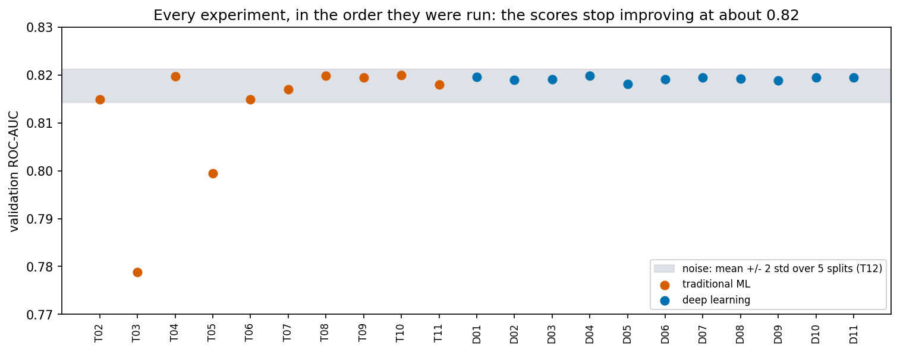
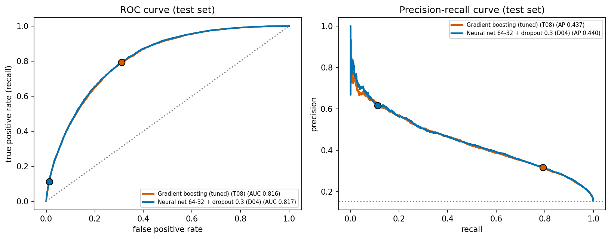

# Diabetes Risk Classification: Traditional Machine Learning vs Deep Learning

Machine Learning summative project, African Leadership University.
Author: *(your name)*

| Deliverable | Link |
|---|---|
| GitHub repository | https://github.com/b-sandrine/summative_introduction_to_machine_learning |
| Google Drive folder (dataset and saved models) | https://drive.google.com/drive/folders/146lM7T1nxHQci1VZSS6UHOByGKVHfQxW?usp=sharing |
| Presentation video | *(add the link after recording)* |

## Problem statement

*(To write in my own words: why predicting diabetes from simple health-survey answers matters, who could use such a tool, and how it connects to my mission.)*

The project asks one question: using only the answers a person gives in a health survey, how well can a model tell who has diabetes, and is a neural network better than traditional machine learning for this?

## Dataset

- **Source:** the CDC Behavioral Risk Factor Surveillance System (BRFSS) survey of 2015, in the "diabetes health indicators" version. It is listed in the [UCI Machine Learning Repository](https://archive.ics.uci.edu/dataset/891/cdc+diabetes+health+indicators) (DOI 10.24432/C53919). The original survey is described on the [CDC BRFSS 2015 page](https://cdc.gov/brfss/annual_data/annual_2015.html).
- **Size:** 253,680 rows and 22 columns (21 answers and the target). No missing values. 24,206 rows are exact duplicates, which are removed in Step 3.
- **Target:** `Diabetes_binary` (0 = no diabetes, 1 = diabetes). About 14% of the people have diabetes. I checked the 3-class file: in the binary file, people with prediabetes are counted as "no diabetes".
- **Licence:** not verified. The UCI page refers to the Kaggle page of the dataset for the licence terms, so check it before reusing the data.
- **Limits:** the answers are self-reported by US adults in 2015. They are not clinical measurements and they do not represent Rwanda or Africa.

The raw CSV files are **not** in this repository (see `.gitignore`). They are in the `dataset/` folder on my computer and zipped in the Google Drive folder above.

## Repository structure

```
notebooks/diabetes_classification.ipynb   the main notebook (Steps 2 to 7)
src/preprocessing.py                      cleaning, new features, split and preprocessing pipeline
src/tracking.py                           metrics and the experiment tracker (CSV table, log files, TensorBoard)
reports/                                  experiment table and test-set results (CSV and markdown)
images/                                   figures used in the report
logs/                                     text logs, epoch-by-epoch logs and TensorBoard runs
models/                                   saved models (the files are on Google Drive, not on GitHub)
dataset/                                  the raw CSV files (ignored by Git)
```

## How the notebook is organised

| Step | Content |
|---|---|
| 2 | Exploratory data analysis |
| 3 | Preprocessing and feature engineering (duplicates, BMI outliers, new features, stratified split, scaling) |
| 4 | Traditional machine learning: baseline, logistic regression, random forest, gradient boosting, SVM, tuning, SMOTE |
| 5 | Deep learning with Keras and `tf.data`: 11 experiments (layers, dropout, batch normalization, optimizers, learning rates, class weights) |
| 6 | Experiment tracking: noise measurement, the complete experiment table, an audit against TensorBoard |
| 7 | Error analysis on the test set: confusion matrices, ROC and precision-recall curves, cut-offs, calibration, bias and variance, subgroups |

Each step has its own numbered sections and ends with a summary and three questions that I answer in my own words.

## How to run

**On a computer**
1. Create an environment with Python 3.11 and install the libraries: `pip install -r requirements.txt`
2. Put the three CSV files in a folder called `dataset/` in the project folder (download them from the Google Drive folder or the UCI page).
3. Open `notebooks/diabetes_classification.ipynb` and run all cells. On a laptop CPU the complete run takes about 15 minutes. The random seed is fixed (`SEED = 42`), so the results should be the same, apart from tiny differences between machines.

**On Google Colab**
1. Upload the project folder (or clone the repository), and upload the three CSV files into a `dataset/` folder next to the notebook (`/content/dataset/` also works).
2. In the first code cell, remove the `#` in front of `!pip install -q imbalanced-learn`. The other libraries are already installed on Colab.
3. Run all cells.

**Looking at the training in TensorBoard**
```
tensorboard --logdir logs/tensorboard
```
Open http://localhost:6006. The HParams tab compares all 24 experiments with their settings and metrics, and the Scalars tab shows the training curves.

## Results

All model selection was done on the validation set. The test set was used once, in Step 7, for the two chosen models.

| Model | Test ROC-AUC | Test recall | Test precision | Test F1 |
|---|---|---|---|---|
| Tuned gradient boosting (T08) | 0.8159 | 0.793 | 0.316 | 0.452 |
| Neural network with dropout (D04) | 0.8172 | 0.112 | 0.615 | 0.190 |

(Precision and recall are at the cut-off 0.5. D04 was trained without class weights and T08 with them. With cut-offs chosen on the validation set, both models behave the same: a recall of about 0.80 with a precision of about 0.31.)

- 22 experiments (11 traditional, 11 deep learning) plus 2 repeat experiments that measure the noise. The complete table is in [`reports/experiment_table.md`](reports/experiment_table.md).
- 16 of the 21 trained models are within 0.002 of the best validation ROC-AUC. The scores stop improving at about 0.82, and the noise between random splits is about 0.0034 (two standard deviations).
- The test ROC-AUC is close to the validation ROC-AUC (0.8199 for both chosen models), so the models generalise to new people from the same survey.





## Using the saved models

The models are in the Google Drive folder. The traditional model needs the `src` folder, because it uses two small classes defined in `src/preprocessing.py`.

```python
import sys, joblib
sys.path.insert(0, "src")                                   # so that joblib can find the custom classes

pipeline = joblib.load("models/best_traditional_model.joblib")
# `answers` is a table with the survey columns plus the four engineered columns
# that src/preprocessing.add_features() creates.
scores = pipeline.predict_proba(answers)[:, 1]              # a score between 0 and 1 for every person
```

The neural network (`models/best_deep_learning_model.keras`) takes the scaled features. Use the fitted preprocessing pipeline (`models/preprocessor.joblib`) first, then `keras.models.load_model(...)`.

## Limitations

- The data are self-reported answers from US adults in 2015. The model has not been tested in Rwanda or anywhere else.
- The label does not include prediabetes. About 1% of the test people have the same answers as a training person with the opposite label, which limits the accuracy any model can reach.
- The scores of the class-weighted model are not probabilities (they are too high). The score of the network trained without weights is close to a real probability.
- The model works differently for different groups: for example it misses most diabetes cases among people aged 18 to 39, and it raises many false alarms among people over 60. See Step 7, section 9.
- This is a prediction from survey answers, not a medical diagnosis and not advice for patients.

## AI assistance

An AI assistant (Claude) helped to write the code and the explanations in the notebook and in this README. All the numbers come from running the code. The answers to the questions at the end of each step and the final report are my own work, and I follow the university's AI-use policy.
